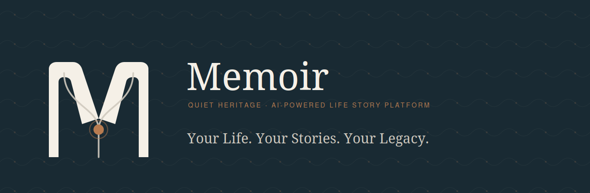
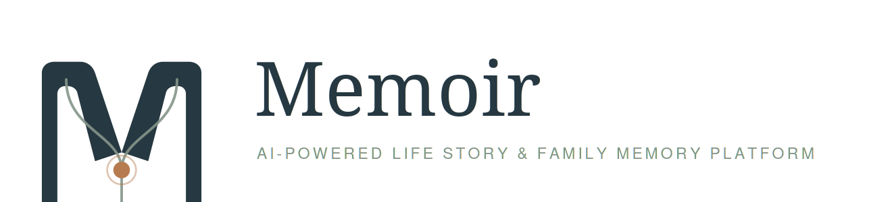

<div align="center">



<p align="center">
  
</p>

<br>

[](https://github.com/zhubao315/memoir/releases)
[](https://python.org)
[](https://fastapi.tiangolo.com)
[](https://vite.dev)
[](LICENSE)
[](https://zhubao315.github.io/memoir/)

**Your Life. Your Stories. Your Legacy.**

一个 AI 原生的个人记忆、人生故事、家庭记忆与数字传承平台。<br>
从一个人的记忆开始，构建一个家庭的数字记忆资产。

[🌐 在线落地页](https://zhubao315.github.io/memoir/) · [📖 文档](#-文档) · [🚀 快速开始](#-快速开始) · [🎭 演示账号](#-演示账号)

</div>

---

## 🎨 品牌 · Quiet Heritage / 静谧传承

Memoir 的品牌视觉以「档案墨蓝建立信任、纸白表达记忆、琥珀表达珍贵瞬间」为核心，贯穿官网、产品 UI、GitHub 与回忆录出版物。

**Memory Fold · 记忆折页** —— 原创 M 型符号：两组对称折页构成稳定轮廓，负空间的连续曲线是记忆路径，琥珀圆点标记值得保存的瞬间；16px 下仍可辨识。

| 颜色 | HEX | 用途 |
| --- | --- | --- |
| Archive Ink 档案墨蓝 | `#263841` | Logo、标题、主要文字 |
| Midnight Archive 深夜档案 | `#192A33` | 深色背景、页脚 |
| Memory Ivory 记忆纸白 | `#F5F0E7` | 网站背景、展示底色 |
| Memory Amber 记忆琥珀 | `#B77B50` | 记忆节点、重点强调 |
| Quiet Sage 传承鼠尾草 | `#85958A` | 辅助图形、状态 |
| Stone Mist 时光石灰 | `#CFC9BE` | 边框、分隔线 |

Logo 变体（全矢量 SVG）：横向标准、独立符号、纵向组合、深色版、单色版、App 图标、多尺寸 Favicon。完整规范见 [`brand/BRAND.md`](brand/BRAND.md)，展示板见 [`brand/brand-board.png`](brand/brand-board.png)。

---

## ✨ 为什么是 Memoir

Remento 把口述回忆录做成了完整的产品闭环。Memoir 以它为对标，但不止于「语音转文字 + AI 润色」——

> **AI 不只是把声音变成文章，而是逐渐理解一个人的人生。**

用户说一句「小时候我经常跟父亲去北京什刹海，那段时间很快乐」，AI 会识别：

| 时间 | 人物 | 地点 | 事件 | 情感 |
| --- | --- | --- | --- | --- |
| 童年 | 父亲 | 北京什刹海 | 父子共同出行 | 快乐、怀念 |

进而提出有价值的追问：「第一次去是什么时候？」「父亲当时喜欢做什么？」，把零散记忆连成不断丰富的人生网络。

**三条不可妥协的设计原则：**

1. **原始内容不可覆盖** —— 录音、逐字稿、AI 故事、人工修改分开保存，原始讲述永远是你的资产。
2. **所有记忆有明确归属** —— 每条记录追溯到用户、家庭空间、权限与来源，服务端强制隔离。
3. **AI 结果可追溯** —— 保存模型、Prompt 版本、输入引用与时间；不确定信息标记「待确认」，不编造。

---

## 🏛 六大产品中心

| 中心 | 能力 |
| --- | --- |
| **01 · Life Studio** 人生工作台 | 记忆/故事/照片/音视频概览、每日记忆问题、最近动态、人生阶段进度、快捷创作 |
| **02 · Memory Vault** 个人记忆库 | 多模态记忆、时间线、人物地点关联、搜索筛选、拖拽上传、回收站与恢复 |
| **03 · Story Studio** AI 故事工作室 | 200 条中文问题库、AI 动态访谈、语音转写、7 种叙事风格、版本对比与恢复 |
| **04 · Family Circle** 家庭空间 | 家庭空间、邀请机制、五种角色分级授权、评论补充与协作 |
| **05 · Legacy Book** 回忆录出版 | 章节编排、封面封底、PDF/Markdown/JSON 导出、可撤销故事二维码 |
| **06 · Digital Legacy** 数字传承 | 显式授权策略、指定分享范围、身份核验、人工审核、完整数据导出 |

### 人生阶段配图（AI 生成，2048×2048）

<table>
  <tr>
    <td align="center"><br><b>童年</b></td>
    <td align="center"><br><b>成家</b></td>
    <td align="center"><br><b>退休</b></td>
    <td align="center"><br><b>回忆录封面</b></td>
  </tr>
</table>

---

## 🔄 核心闭环

```
Capture 采集  →  Transform 转写  →  Create 生成  →  Preserve 传承
语音/照片/视频    ASR 转逐字稿       AI 多风格故事     家庭 / 出版 / 授权
文字 / 问题引导    人工可修正         事实保护 + 版本     数字资产长期保存
```

- **真实 ASR**：Qwen3-ASR-0.6B（OpenAI 兼容适配器）
- **真实 TTS**：Qwen3-TTS VoiceDesign（10 语种音色设计）
- **AI 故事**：OpenAI / Anthropic 兼容适配器 + 离线 Mock（无 Key 时不伪造服务）
- **RAG 问答**：基于授权记忆的私人 AI，每条回答带来源引用

---

## 🚀 快速开始

### 本地开发（零外部依赖，Mock AI）

```bash
# 后端
cd backend
python -m venv .venv && source .venv/bin/activate
pip install -r requirements.txt
cp ../.env.example .env
uvicorn main:app --reload --port 8000     # http://127.0.0.1:8000/docs

# 前端（另一个终端）
cd frontend
npm install
npm run dev                               # http://127.0.0.1:5173
```

默认使用 SQLite + 本地文件存储 + Mock AI/ASR/图片，**无需任何 API Key** 即可跑通全流程。

### 生产部署

```bash
cp .env.example .env
# 修改 SECRET_KEY（>=32 位）、DATABASE_URL、CORS_ORIGINS、AI_*、ASR_*、S3_*
docker compose up -d --build
docker compose exec api alembic upgrade head
```

> ⚠️ GitHub Pages 只托管静态落地页，不运行后端。完整应用需按 [部署指南](docs/DEPLOYMENT.md) 部署后端。

---

## 🎭 演示账号

| 用户名 | 密码 | 说明 |
| --- | --- | --- |
| **林一** | **123456** | 完整演示：20 条记忆、20 篇故事、200 问题库、阶段配图、封面封底、5 段 TTS 口述录音、家庭、回忆录、数字传承 |
| demo | 123456 | 基础演示账号 |
| 林晓 | 123456 | 家庭成员（协作者） |

详见 [测试账号说明](docs/TEST_ACCOUNTS.md)。

---

## 📖 文档

- [部署指南](docs/DEPLOYMENT.md)
- [API 文档](docs/API.md)
- [用户手册](docs/USER_MANUAL.md)
- [测试账号](docs/TEST_ACCOUNTS.md)
- 审计与架构：
  - [项目审计](docs/audit/PROJECT_AUDIT.md) · [安全审计](docs/audit/SECURITY_AUDIT.md) · [数据模型审计](docs/audit/DATA_MODEL_AUDIT.md)
  - [目标架构](docs/architecture/TARGET_ARCHITECTURE.md) · [数据模型总览](docs/architecture/DATA_MODEL_OVERVIEW.md)
  - [记忆与资源模型](docs/architecture/DATA_MODEL_MEMORY.md) · [故事模型](docs/architecture/DATA_MODEL_STORY.md) · [家庭与传承模型](docs/architecture/DATA_MODEL_FAMILY_LEGACY.md)
- [迭代进度](docs/PROGRESS.md) · [变更记录](docs/CHANGELOG.md) · [架构决策](docs/DECISIONS.md)

---

## 🧪 测试

```bash
cd backend && pytest tests -q      # 38 passed
cd frontend && npm run build       # 构建通过
```

测试覆盖：认证与刷新/撤销、legacy API 兼容、媒体上传与签名 URL、200 问题库、访谈动态追问、故事多版本与恢复、RAG、家庭权限拒绝、书籍导出与二维码、数字遗产显式授权，以及 30+ 项跨用户逻辑隔离回归测试。

---

## 🛠 技术栈

**前端** React 18 · TypeScript · Vite · 响应式 · 老年简洁模式<br>
**后端** FastAPI · Pydantic v2 · SQLAlchemy 2.x · 模块化单体 + 独立 Worker<br>
**数据** SQLite（开发）/ PostgreSQL + pgvector（生产） · Alembic 迁移<br>
**存储** 本地（HMAC 签名 URL）/ S3 兼容（MinIO）<br>
**AI** Provider Adapter（OpenAI-compatible / Anthropic-compatible / Local / Mock）· ASR · TTS · RAG<br>
**部署** Docker Compose · Nginx · GitHub Actions · Pages

---

<div align="center">

**让每个人都能轻松记录自己的人生，让每个家庭都拥有可以传承的数字记忆。**

© 2026 Memoir · Open Source

</div>
