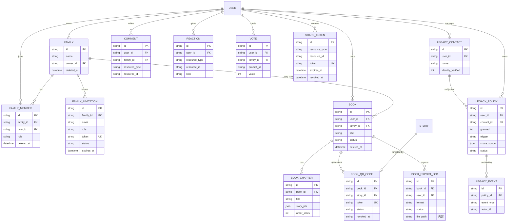

# 家庭空间 · 回忆录 · 数字传承 数据模型

> 适用范围：`family` / `book` / `digital_legacy` 三个模块及其领域模型。
> 设计原则：**服务端资源级鉴权**（绝不靠前端隐藏按钮）、**归属清晰**、**最小分享范围**、**显式授权 + 可撤销 + 人工审核**。

---

## 0. 归属与隔离总则

| 原则 | 落地方式 |
| --- | --- |
| 所有资源有 owner | 业务表带 `user_id` / `owner_id`；查询一律带归属过滤，防止 IDOR |
| 家庭资源级鉴权 | `family_role()` + `require_role()` 先校验成员身份与角色，再允许访问 |
| 多家庭隔离 | `family_members` 唯一标识 `(family_id, user_id)`；邀请绑定具体家庭；跨家庭不共享角色 |
| 二维码最小暴露 | 公开页只接受 `BookQRCode.token`（稳定且不可预测）；不返回 `file_path` / `storage_key` / `target_url` |
| 传承不自动交付 | 策略默认 `granted=0` / `status=draft`；交付必须人工审核，无自动 release 接口 |
| 分享范围明确 | `share_scope` 只接受 `story:<id>` / `memory:<id>`，拒绝 `all`/`*` 通配符 |

---

## 1. 实体字段

> 通用 mixin：`UUIDMixin.id`(str, PK, uuid4)、`TimestampMixin.created_at/updated_at`、`SoftDeleteMixin.deleted_at`（带该 mixin 的表支持软删除）。

### 1.1 Family（家庭空间）

| 字段 | 类型 | 说明 |
| --- | --- | --- |
| `id` | str PK | UUID |
| `name` | str NOT NULL | 家庭名称 |
| `description` | text NULL | 描述 |
| `owner_id` | str NOT NULL, idx | 创建者/所有者 user_id |
| `avatar_url` | str NULL | 头像 URL |
| `created_at/updated_at/deleted_at` | datetime | 时间戳 + 软删除 |

### 1.2 FamilyMember（家庭成员）

| 字段 | 类型 | 说明 |
| --- | --- | --- |
| `id` | str PK | UUID |
| `family_id` | str NOT NULL, idx | 所属家庭 |
| `user_id` | str NOT NULL, idx | 用户 ID |
| `role` | str NOT NULL, default `collaborator` | `owner/admin/storyteller/collaborator/viewer` |
| `display_name` | str NULL | 家庭内显示名 |
| `invited_by` | str NULL | 邀请人 user_id |
| `joined_at` | datetime NULL | 加入时间 |
| `deleted_at` | datetime NULL | 非空 = 已被移除，立即失去权限 |

**索引建议**：`(family_id, user_id)` 唯一复合索引（同一家庭不重复成员）；`user_id` 单列索引支撑「我的家庭」列表。

### 1.3 FamilyInvitation（家庭邀请）

| 字段 | 类型 | 说明 |
| --- | --- | --- |
| `id` | str PK | UUID |
| `family_id` | str NOT NULL, idx | 归属家庭 |
| `email` | str NOT NULL, idx | 被邀邮箱 |
| `role` | str default `collaborator` | 授予角色（不能为 owner） |
| `token` | str UNIQUE, idx | `secrets.token_urlsafe(24)`，不可预测 |
| `status` | str default `pending` | `pending/accepted/expired/revoked` |
| `expires_at` | datetime NOT NULL | 有效期（接口层 1~30 天，默认 7 天） |
| `invited_by` | str NOT NULL | 邀请人 |

### 1.4 Book（回忆录）

| 字段 | 类型 | 说明 |
| --- | --- | --- |
| `id` | str PK | UUID |
| `user_id` | str NOT NULL, idx | 所有者（服务端强制过滤） |
| `family_id` | str NULL, idx | 可选归属家庭（需校验成员身份） |
| `title/subtitle/author` | str | 书名/副标题/作者 |
| `cover_media_id` | str NULL | 封面媒体 ID（不存路径） |
| `template` | str default `classic` | 版式 |
| `status` | str default `draft` | `draft/ready/exported` |
| `settings` | JSON NULL | 如 `back_cover_media_id`（封底） |
| `deleted_at` | datetime | 软删除 |

### 1.5 BookChapter（章节）

| 字段 | 类型 | 说明 |
| --- | --- | --- |
| `id` | str PK | UUID |
| `book_id` | str NOT NULL, idx | 所属书籍 |
| `title` | str NOT NULL | 章节标题 |
| `intro/content` | text NULL | 引言/正文 |
| `cover_media_id` | str NULL | 章节封面 |
| `story_ids` | JSON NULL | 引用的**本人**故事 ID |
| `media_ids` | JSON NULL | 引用的**本人**媒体 ID |
| `order_index` | int default 0 | 排序；`PUT /chapters/{id}` 仅传此字段实现上移/下移（部分更新，不覆盖正文） |

### 1.6 BookQRCode（二维码）

| 字段 | 类型 | 说明 |
| --- | --- | --- |
| `id` | str PK | UUID |
| `book_id/story_id/chapter_id` | str NULL, idx | 绑定目标 |
| `token` | str UNIQUE, idx | 稳定不可预测公开令牌 |
| `target_url` | str NULL | 内部使用，**不返回前端** |
| `status` | str default `active` | `active/revoked` |
| `revoked_at` | str NULL | 撤销时间 |

### 1.7 BookExportJob（导出任务）

| 字段 | 类型 | 说明 |
| --- | --- | --- |
| `id` | str PK | UUID |
| `book_id/user_id` | str NOT NULL, idx | 归属 |
| `format` | str | `pdf/markdown/json`（epub 预留） |
| `status` | str default `pending` | `pending/completed/failed` |
| `file_path` | str NULL | **内部路径，不出现在响应中** |
| `error` | text NULL | 失败原因 |

### 1.8 LegacyContact（传承联系人）

| 字段 | 类型 | 说明 |
| --- | --- | --- |
| `id` | str PK | UUID |
| `user_id` | str NOT NULL, idx | 所有者，仅本人可管理 |
| `name/email/phone/relationship` | str | 联系信息 |
| `identity_verified` | int default 0 | 人工核验结果，非自动 |
| `verification_method` | str NULL | 核验方式 |

### 1.9 LegacyPolicy（访问策略）

| 字段 | 类型 | 说明 |
| --- | --- | --- |
| `id` | str PK | UUID |
| `user_id` | str NOT NULL, idx | 所有者 |
| `contact_id` | str NOT NULL, idx | 关联联系人 |
| `granted` | int default 0 | **必须显式授权** |
| `granted_at/revoked_at` | datetime NULL | 授权/撤销时间 |
| `trigger` | str default `manual` | `manual/scheduled` |
| `release_after_days/release_at` | int/datetime NULL | 触发条件（不自动执行） |
| `share_scope` | JSON NULL | 仅 `story:<id>`/`memory:<id>`；空 = 不交付任何内容 |
| `conditions` | JSON NULL | 其他人工审核条件 |
| `status` | str default `draft` | `draft/active/disputed/revoked/released` |

### 1.10 LegacyEvent（策略事件）

| 字段 | 类型 | 说明 |
| --- | --- | --- |
| `id` | str PK | UUID |
| `policy_id` | str NOT NULL, idx | 所属策略 |
| `event_type` | str NOT NULL | `created/granted/revoked/triggered/verified/disputed/released` |
| `actor_id` | str NULL | 操作人 |
| `detail` | text NULL | 事件详情（如 share_scope 快照） |

### 1.11 Comment / Reaction / Vote / ShareToken（协作模型，位于 `collaboration.py`）

| 模型 | 关键字段 | 说明 |
| --- | --- | --- |
| `Comment` | `user_id`, `family_id?`, `resource_type`, `resource_id`, `content`, `parent_id` | 评论；可属家庭，可回复；按 `resource_id` 索引 |
| `Reaction` | `user_id`, `resource_type`, `resource_id`, `kind`(`heart/like/remember`) | 表情回应，按 `resource_id` 索引 |
| `Vote` | `user_id`, `family_id?`, `prompt_id`, `value` | 家庭投票，按 `prompt_id`/`family_id` 索引 |
| `ShareToken` | `resource_type`, `resource_id`, `token`(UNIQUE), `created_by`, `expires_at?`, `revoked_at?`, `permissions`(`read/listen`) | 通用分享令牌；可过期/撤销，与 QR token 同属「不可预测令牌」思想 |

> 这些协作表本身不直接提供「公开数据交付」能力；任何分享仍须经资源归属/可见性校验。

---

## 2. 角色权限矩阵（家庭资源）

| 操作 | owner | admin | storyteller | collaborator | viewer |
| --- | :---: | :---: | :---: | :---: | :---: |
| 查看家庭详情 / 成员 | ✅ | ✅ | ✅ | ✅ | ✅ |
| 生成邀请（非 owner 角色） | ✅ | ✅ | ❌ | ❌ | ❌ |
| 列出/撤销邀请 | ✅ | ✅ | ❌ | ❌ | ❌ |
| 接受邀请加入家庭 | — | — | — | — | —（已登录即可） |
| 修改普通成员角色 | ✅ | ✅（仅低于 admin 的角色） | ❌ | ❌ | ❌ |
| 修改/移除管理员 | ✅ | ❌ | ❌ | ❌ | ❌ |
| 移除普通成员 | ✅ | ✅（仅低于 admin） | ❌ | ❌ | ❌ |
| 修改/移除 owner、修改自己角色 | ❌ | ❌ | ❌ | ❌ | ❌ |

**说明**：能力在服务端由 `require_role(db, family_id, user_id, allowed)` 判定；`viewer` 等只读角色无法调用任何写接口，即使前端按钮被绕过也返回 403。

---

## 3. 状态机

### 3.1 邀请（FamilyInvitation）

```
        create (owner/admin)
              │
              ▼
           pending ──────accept（校验 status=pending 且未过期）──────▶ accepted
              │
              ├──────revoke（owner/admin）─────────────────────────▶ revoked
              └──────accept 时 expires_at 已过 / 后台清理──────────▶ expired
```

- 服务端 `accept` 同时校验 `status == pending` 与 `expires_at > now`，过期时落库为 `expired`。
- `revoked` / `accepted` / `expired` token 一律不可再次使用。

### 3.2 二维码（BookQRCode）

```
   create（绑定可见性为 family/public 的故事）──▶ active
                                                   │
                                            revoke（本人）
                                                   ▼
                                                revoked
```

- `public_story(token)` 同时校验 `status == active` 与故事可见性；任一不满足 → 403/404。
- `family` 可见故事还需登录且为作者或家庭成员；`private` 故事不可创建公开二维码，也不可匿名访问。
- 撤销即时生效，响应只含相对 URL `/public/story/{token}`，不含任何内部存储路径。

### 3.3 策略（LegacyPolicy）

```
   create ─▶ draft ──grant（显式）──▶ active
              │                        │
              │                        ├──revoke──▶ revoked
              │                        ├──人工判定争议──▶ disputed
              │                        └──审核通过并交付──▶ released
              └──revoke（未授权草稿也可直接撤销）──▶ revoked
```

- `grant` 仅限本人、且 `status != revoked`；`revoke` 随时可用并写 `LegacyEvent`。
- `trigger-review` 仅 `active && granted` 可调用，只写一条 `triggered` 事件并进入人工流程；**系统不自动 release**。
- 已撤销策略不可重新 grant（需新建策略），避免误操作恢复交付。

---

## 4. Mermaid ER 图



---

## 5. 索引与查询模式

| 表 | 关键索引 | 支撑查询 |
| --- | --- | --- |
| `families` | `owner_id`, `deleted_at` | 我的家庭列表 |
| `family_members` | `family_id`, `user_id`（建议复合唯一） | 角色判定、我的家庭 |
| `family_invitations` | `token`(UNIQUE), `family_id`, `email` | token 接受、邀请列表 |
| `books` | `user_id`, `family_id`, `deleted_at` | 我的书籍、书单 |
| `book_chapters` | `book_id`（排序 `order_index, created_at`） | 章节列表/排序 |
| `book_qr_codes` | `token`(UNIQUE), `book_id`, `story_id` | 公开访问、二维码列表 |
| `book_export_jobs` | `book_id`, `user_id` | 导出记录 |
| `legacy_contacts` | `user_id` | 我的联系人 |
| `legacy_policies` | `user_id`, `contact_id` | 我的策略 |
| `legacy_events` | `policy_id` | 事件时间线 |
| `collaboration.*` | `resource_id` / `prompt_id` / `token`(UNIQUE) | 评论/回应/投票/分享 |

---

## 6. 接口与权限加固对照

| 风险 | 加固点 | 验证测试 |
| --- | --- | --- |
| 非成员读取家庭 | `get_family`/`members` 先 `require_role` | `test_family_cross_user_and_member_removal` |
| 已移除成员仍可访问 | `family_role` 过滤 `deleted_at` | 同上 |
| viewer 越权邀请/改角色/移除 | `MANAGER_ROLES` 限制 | 同上 |
| 跨家庭串号 | 邀请/成员/书籍均带 family_id 校验 | `test_family_invitation_revoke_and_multi_family` |
| 过期/撤销 token 仍可用 | accept 校验 status + expires_at | 同上 |
| 他人修改/导出书籍与二维码 | `_owned_book` 统一归属校验 | `test_book_cross_user_cannot_modify_or_export` |
| 私有故事匿名访问 | QR 校验可见性 + 登录态 | `test_public_qr_visibility_and_revocation` |
| 二维码含内部路径 | 响应只含相对 URL | 同上 |
| 他人管理传承策略 | `_owned_contact` / `_owned_policy` 归属校验 | `test_digital_legacy_cross_user_isolation` |
| 自动交付数据 | 无自动 release 接口；grant + 人工审核 | `test_digital_legacy_explicit_consent_and_scope` |
| share_scope 通配符 | 接口层拒绝 `all`/`*` | 同上 |

测试文件：`backend/tests/test_family_legacy_isolation.py`（跨用户越权回归）。
