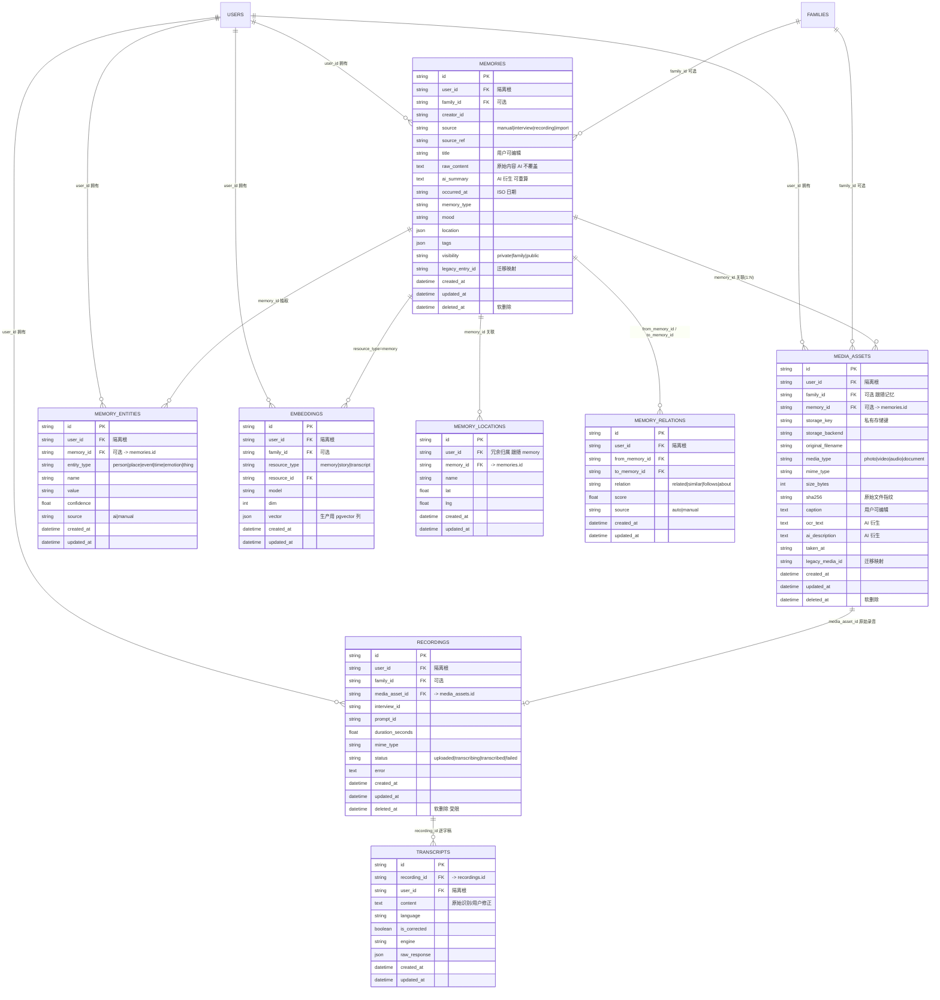

# 记忆与资源中心 · 数据模型设计

> 适用范围：记忆（Memory Vault）与媒体资源（Media Gallery）领域。
> 原则：**原始内容不可变（A）**、**私有存储 + 短时效签名 URL（私有资源）**、**AI 衍生内容与原始内容分离且可重算（C）**。
> 本领域的 ORM 定义在 `app/models/memory.py`、`app/models/media.py`；`MemoryEntity` / `Embedding` 定义在
> `app/models/ai.py`（由 AI 模块维护，本文只描述其契约与索引建议）。

---

## 1. 总览与归属模型

所有本领域的表都带 `user_id`，它是**隔离的根**：任何查询、修改、删除都必须带
`user_id = 当前登录用户.id` 过滤，跨用户访问统一返回 **404**（不泄漏资源是否存在），
未认证返回 **401**，家庭越权返回 **403**。

- `user_id`：资源所有者；与 `users.id` 对应，可信来源永远是服务端的 `get_current_user()`，
  不信任请求体/表单里的 `user_id`。
- `family_id`：可选的家庭空间。家庭可见性由 `FamilyMember`（`role` + `deleted_at`）决定；
  上传/移动时如果指定了 `family_id`，必须校验当前用户是该家庭成员。
- 当媒体挂在某段记忆上时（`media_assets.memory_id` 非空），媒体的 `family_id` **跟随记忆**，
  由服务端覆盖，避免通过表单参数把资产写进其它家庭。

### 原始内容 vs AI 衍生内容（原则 A / C）

| 类别 | 字段 | 可变性 | 说明 |
|---|---|---|---|
| 原始事实 | `memories.raw_content`、`media_assets.storage_key` / `sha256` / `mime_type` / `size_bytes`、`recordings.media_asset_id`、`transcripts.content` | 用户/系统写入后 AI **永不覆盖** | `raw_content` 仅允许用户手动修订并记审计 |
| 用户可编辑 | `memories.title` / `tags` / `mood`、`media_assets.caption` | 用户可改 | `caption` 经长度截断（≤500） |
| AI 衍生（可重算） | `memories.ai_summary`、`media_assets.ocr_text` / `ai_description`、`memory_entities`、`embeddings` | 可重建/覆盖 | 由异步 AI Job 生成，失败不影响原始内容；重跑幂等 |
| 转录 | `transcripts.content` / `is_corrected` | 用户可修正 | 修正写入新版本记录，不修改原始识别结果 |

软删除：`Memory` / `MediaAsset` / `Recording` 继承 `SoftDeleteMixin`（`deleted_at`），
默认列表/详情/签名 URL 均过滤 `deleted_at IS NULL`；`Memory` 支持回收站（restore）与彻底删除（purge）。
`Transcript` / `MemoryEntity` / `Embedding` / `MemoryLocation` / `MemoryRelation` 为派生或附属数据，
随主记录的删除通过 purge 流程清理（无独立回收站）。

---

## 2. 实体关系图（Mermaid）

---

## 3. 各表字段与约束

### 3.1 Memory（`memories`）
- 归属：`user_id`（必填）、`family_id`（可选，成员校验）、`creator_id`（记录创建者）。
- 原始内容：`raw_content`；AI 摘要：`ai_summary`（可重算）。
- 描述：`title` / `occurred_at` / `memory_type` / `mood` / `location`(JSON) / `tags`(JSON) / `visibility`。
- 来源追踪：`source` / `source_ref`；迁移：`legacy_entry_id`。
- 软删除：`deleted_at`；`created_at` / `updated_at` 由 `TimestampMixin` 维护。

### 3.2 MediaAsset（`media_assets`）
- 归属：`user_id`（必填）、`family_id`（可选）、`memory_id`（可选，归属必须属于同一 `user_id`）。
- 原始事实：`storage_key` / `storage_backend` / `sha256` / `mime_type` / `size_bytes` / `original_filename`。
- 用户可编辑：`caption`（≤500 字符）。
- AI 衍生：`ocr_text` / `ai_description`。
- 软删除：`deleted_at`；删除时删除私有存储对象并硬删记录（原始录音例外，见 3.3）。

### 3.3 Recording（`recordings`）
- 归属：`user_id`、`family_id`；关联 `media_asset_id`（原始音频资产）。
- 状态机：`uploaded → transcribing → transcribed | failed`，`error` 记录失败原因。
- 原始录音**永久保留**：无 update 接口，只能受限软删除；`DELETE /media/{id}` 对绑定录音的资产返回 403。

### 3.4 Transcript（`transcripts`）
- 归属：`user_id`；关联 `recording_id`。
- `content` 为转录文本；`is_corrected` 标记是否经过用户修正；`engine` / `raw_response` 记录 AI 元数据。
- 修正写入新记录，保留原始识别结果（原则 A）。

### 3.5 MemoryLocation（`memory_locations`）
- 归属：`user_id`（冗余，跟随 memory）、`memory_id`；`name` / `lat` / `lng`。
- 作为记忆的地点结构化补充（`memories.location` JSON 是轻量快照）。

### 3.6 MemoryRelation（`memory_relations`）
- 归属：`user_id`；`from_memory_id` / `to_memory_id`；`relation` / `score` / `source`。
- 两端记忆必须属于同一 `user_id`，防止跨用户关系图谱污染。

### 3.7 MemoryEntity（`memory_entities`，定义于 `app/models/ai.py`）
- 归属：`user_id`；可选 `memory_id`；`entity_type` / `name` / `value` / `confidence` / `source`。
- AI 抽取的实体，可随 `memory_extraction` Job 重算。

### 3.8 Embedding（`embeddings`，定义于 `app/models/ai.py`）
- 归属：`user_id`、`family_id`（可选）；`resource_type` / `resource_id` 指向被索引资源。
- `model` / `dim` / `vector`（JSON，生产环境替换为 pgvector 列）。
- 检索强制带 `user_id` 过滤，`family_id` 采用“成员可见或空”的过滤策略。

---

## 4. 索引建议

所有隔离查询都以 `user_id` 为最左前缀；下列复合索引已在 ORM `__table_args__` 中声明：
（SQLite 开发环境靠 `create_all` 建表；生产迁移需同步创建）

| 表 | 索引 | 用途 |
|---|---|---|
| `memories` | `(user_id, deleted_at, created_at)` | 我的记忆列表：按用户 + 未删除 + 时间倒序 |
| `memories` | `(user_id, family_id)` | 按家庭空间筛选记忆 |
| `memories` | `legacy_entry_id`（单列） | 迁移去重 / 回溯 legacy |
| `media_assets` | `(user_id, deleted_at, created_at)` | 我的媒体列表 + 未删除过滤 |
| `media_assets` | `(user_id, memory_id)` | 按记忆聚合媒体（`/memories/{id}/media`） |
| `recordings` | `(user_id, media_asset_id)` | 校验资产是否绑定录音、查原始录音 |
| `transcripts` | `(user_id, recording_id)` | 按录音查逐字稿（带隔离） |
| `memory_locations` | `(user_id, memory_id)` | 按记忆查地点 |
| `memory_relations` | `(user_id, from_memory_id)` | 图谱遍历起点 |
| `memory_entities` | `(user_id, memory_id)`（建议） | 按记忆查实体 |
| `embeddings` | `(user_id, resource_type, resource_id)`（建议，唯一） | 检索 + upsert 幂等；生产加向量索引（ivfflat/hnsw） |

> 建议对 `(user_id, resource_type, resource_id)` 加唯一约束，保证重跑 embedding 任务时幂等覆盖而非重复插入。

---

## 5. 与 legacy `entries` / `media` 的迁移映射

旧表（`app/models/legacy_tables.py`，**保持原样、不得改动**）继续服务 `/api/entries` 等 v0.1 接口。
新领域表通过冗余 ID 字段建立可回溯映射，支持增量/灰度迁移。

| legacy 字段 | 新表字段 | 转换说明 |
|---|---|---|
| `entries.id` | `memories.legacy_entry_id` | 保留原 ID，幂等去重 |
| `entries.user_id` | `memories.user_id` | 直接迁移，作为隔离根 |
| `entries.title` | `memories.title` | 直接迁移 |
| `entries.content` | `memories.raw_content` | 原始内容，AI 不得覆盖 |
| `entries.entry_date` | `memories.occurred_at` | 归一化为 ISO 日期字符串 |
| `entries.entry_type` | `memories.memory_type` | 值域对齐 `memory/milestone/daily/travel` |
| `entries.mood` | `memories.mood` | 直接迁移 |
| `entries.location` | `memories.location` | JSON 快照；可再生成 `memory_locations` 行 |
| `entries.tags` | `memories.tags` | JSON 数组直接迁移 |
| `entries.is_public` | `memories.visibility` | `true → public`，`false → private` |
| `entries.created_at` / `updated_at` | 同名 | 直接迁移 |
| `media.id` | `media_assets.legacy_media_id` | 保留原 ID，幂等去重 |
| `media.entry_id` | `media_assets.memory_id` | 通过 `entries.id → memories.legacy_entry_id` 反查新 `memories.id` |
| `media.user_id` | `media_assets.user_id` | 直接迁移，作为隔离根 |
| `media.file_path` | `media_assets.storage_key` | 文件迁入私有存储后的键；`storage_backend='local'` |
| `media.filename` | `media_assets.original_filename` | 直接迁移 |
| `media.file_type` | `media_assets.media_type` | 值域对齐 `photo/video/audio/document` |
| `media.file_size` | `media_assets.size_bytes` | 直接迁移 |
| `media.mime_type` | `media_assets.mime_type` | 直接迁移 |
| `media.caption` | `media_assets.caption` | 直接迁移 |
| `media.taken_at` | `media_assets.taken_at` | DateTime → ISO 字符串 |

迁移原则：
1. 保留 legacy 表与旧接口不变，新表通过 `legacy_*_id` 建立一一映射，支持回滚。
2. 音频类 `media` 迁移时，同时创建 `Recording` 行（`status='uploaded'`）绑定对应 `MediaAsset`，
   以继承“原始录音永久保留”的保护策略。
3. `ocr_text` / `ai_description` / `ai_summary` / `MemoryEntity` / `Embedding` 不随迁移填充，
   由异步 Job 重算，保证衍生数据与原始内容解耦。

---

## 6. 隔离契约速查（API 层）

| 场景 | 规则 |
|---|---|
| 列出记忆/媒体 | `WHERE user_id = ? AND deleted_at IS NULL` |
| 详情 / 签名 URL | 带 `user_id` + `deleted_at IS NULL`，否则 404 |
| 更新 / 删除记忆 | 带 `user_id` + 软删除状态，否则 404 |
| 上传到指定记忆 | 先查 `memories` 的 `user_id` 归属，越权 404；家庭越权 403 |
| 移动媒体到其它记忆 | 校验资产所有权 + 目标记忆所有权，越权 404 |
| 家庭写入 | 校验 `FamilyMember`，越权 403 |
| 未认证 | `get_current_user` 返回 401 |
