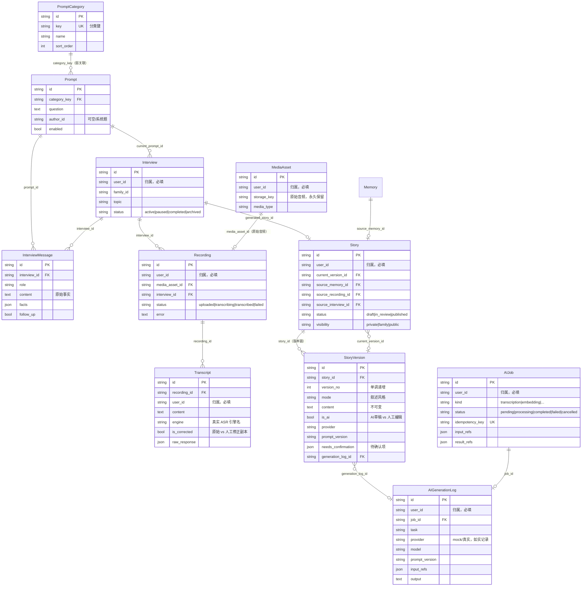

# Story Studio 数据模型设计

> 适用范围：问题库（Prompt）、AI 访谈（Interview）、录音（Recording）、转录（Transcript）、
> 故事与多版本（Story / StoryVersion）、异步任务（AIJob）、生成审计（AIGenerationLog）。
>
> 设计三原则：**归属必填（资源级授权）** · **原始事实不可变** · **AI 输出可追溯**。
> AI 当前运行在 Mock Provider（`_provider=mock`），记录中的 `provider / model / prompt_version`
> 如实反映实际调用，未接入真实模型时不会伪造成真实服务。

---

## 0. 归属与隔离总览

| 实体 | 表 | 归属字段 | 隔离规则 |
| --- | --- | --- | --- |
| PromptCategory | `prompt_categories` | 无（全局系统数据） | 只读种子数据，不含用户内容 |
| Prompt | `prompts` | `author_id`（可空，系统题为 null） | 问题库只读；用户投稿按 `author_id` 归属 |
| Interview | `interviews` | **`user_id`（必填）** | 列表/详情/消息/回答/暂停全部按 `user_id` 过滤 |
| InterviewMessage | `interview_messages` | 经 `interview_id` 间接归属 | 先校验父 Interview 归属，再读消息 |
| Recording | `recordings` | **`user_id`（必填）** | 详情按 `user_id`；关联资产/访谈亦校验归属 |
| Transcript | `transcripts` | **`user_id`（必填）** | 读/修正均校验 `user_id` + 关联 recording 归属 |
| Story | `stories` | **`user_id`（必填）** | 列表/详情/编辑/恢复/删除/可见性全按 `user_id` |
| StoryVersion | `story_versions` | 经 `story_id` 间接归属 | 先校验父 Story 归属，再读版本 |
| AIJob | `ai_jobs` | **`user_id`（必填）** | 后台任务按 `user_id` 溯源；input_refs 资源须归属 |
| AIGenerationLog | `ai_generation_logs` | **`user_id`（必填）** | 生成审计只记录当前用户，禁止跨用户查询 |

> **IDOR 防护要点（已实现于 `services/story.py::source_text`）**：任何 `recording_id /
> memory_id / interview_id` 作为生成素材时，必须同时满足 `id == 传入值 AND user_id == 当前用户
> AND deleted_at IS NULL`；跨用户或已删除资源统一返回 404，既不返回内容，也不泄漏资源是否存在。
> 调用处（`generate` / `regenerate`）全部显式传入 `user.id`。

---

## 1. 实体字段

### 1.1 PromptCategory（问题分类）

| 字段 | 类型 | 说明 |
| --- | --- | --- |
| `id` | String(PK, UUID) | 主键 |
| `key` | String, unique, idx | 分类键，如 `childhood` / `family_parents`，20 类种子数据 |
| `name` | String | 中文显示名 |
| `description` | Text? | 分类说明 |
| `sort_order` | Integer | 展示排序 |
| `created_at` / `updated_at` | DateTime | 时间戳 |

### 1.2 Prompt（问题库）

| 字段 | 类型 | 说明 |
| --- | --- | --- |
| `id` | String(PK, UUID) | 主键 |
| `category_key` | String, idx | 关联 `PromptCategory.key`（非外键，弱关联） |
| `question` | Text | 问题正文 |
| `hint` | Text? | 追问提示 |
| `is_system` | Boolean | 系统种子题 vs 用户投稿 |
| `author_id` | String? | 投稿用户（系统题为 null） |
| `family_id` | String?, idx | 家庭共享范围 |
| `enabled` | Boolean | 是否启用（软开关） |
| `times_used` | Integer | 使用次数（按升序推荐冷门好问题） |
| `quality_score` | Integer? | 质量分（投票/反馈聚合） |
| `deleted_at` / `created_at` / `updated_at` | DateTime | 软删除 + 时间戳 |

### 1.3 Interview（访谈会话）

| 字段 | 类型 | 说明 |
| --- | --- | --- |
| `id` | String(PK, UUID) | 主键 |
| `user_id` | String, idx, **必填** | 归属用户 |
| `family_id` | String?, idx | 家庭范围 |
| `topic` | String? | 主题键（对应 PromptCategory.key） |
| `title` | String? | 访谈标题 |
| `status` | String, default=`active` | 状态机见 §4.1 |
| `current_prompt_id` | String? | 当前追问对应的 Prompt |
| `summary` | Text? | 访谈摘要 |
| `generated_story_id` | String?, idx | 由该访谈生成的故事（回填） |
| `deleted_at` / `created_at` / `updated_at` | DateTime | 软删除 + 时间戳 |

### 1.4 InterviewMessage（访谈消息）

| 字段 | 类型 | 说明 |
| --- | --- | --- |
| `id` | String(PK, UUID) | 主键 |
| `interview_id` | String, idx, **必填** | 父访谈（归属经父级校验） |
| `role` | String | `interviewer` / `interviewee` / `system` |
| `content` | Text | 消息正文（回答为**原始事实**，不被 AI 覆盖） |
| `prompt_id` | String? | 引用问题 |
| `recording_id` | String? | 关联录音（须归属当前用户） |
| `facts` | JSON? | `extract_facts` 抽取的 time/person/place/event/emotion |
| `follow_up` | Boolean | 是否 AI 动态追问 |
| `created_at` / `updated_at` | DateTime | 时间戳 |

### 1.5 Recording（录音记录）

| 字段 | 类型 | 说明 |
| --- | --- | --- |
| `id` | String(PK, UUID) | 主键 |
| `user_id` | String, idx, **必填** | 归属用户 |
| `family_id` | String?, idx | 家庭范围 |
| `media_asset_id` | String?, idx | 原始音频文件（存于媒体库，永久保留） |
| `interview_id` | String?, idx | 关联访谈（须归属当前用户） |
| `prompt_id` | String? | 关联问题 |
| `duration_seconds` | Float? | 时长 |
| `mime_type` | String? | 音频 MIME |
| `status` | String, default=`uploaded` | 状态机见 §4.2 |
| `error` | Text? | 失败原因（供前端展示「失败」状态） |
| `deleted_at` / `created_at` / `updated_at` | DateTime | 软删除 + 时间戳 |

> **事实保护**：原始录音无 update 接口，只有受限软删除；删除媒体资产时若存在关联录音会被拒绝。

### 1.6 Transcript（逐字稿）

| 字段 | 类型 | 说明 |
| --- | --- | --- |
| `id` | String(PK, UUID) | 主键 |
| `recording_id` | String, idx, **必填** | 关联录音 |
| `user_id` | String, idx, **必填** | 归属用户（独立于录音再次校验） |
| `content` | Text | 转写正文 |
| `language` | String? | 语种 |
| `is_corrected` | Boolean | false = 原始 ASR 输出；true = 人工修正副本 |
| `engine` | String? | **真实 ASR 引擎名**（如 `qwen3-asr-0.6b` / `mock`），如实展示 |
| `raw_response` | JSON? | ASR 原始响应（可追溯，含 provider/bytes/filename） |
| `created_at` / `updated_at` | DateTime | 时间戳 |

> **事实保护（原始/人工分离）**：`PUT /transcripts/{id}` 不覆盖原始记录，而是新增一条
> `is_corrected=true` 的修正副本，`engine` 沿用原引擎；故事生成始终优先取最新逐字稿。

### 1.7 Story（故事）

| 字段 | 类型 | 说明 |
| --- | --- | --- |
| `id` | String(PK, UUID) | 主键 |
| `user_id` | String, idx, **必填** | 归属用户 |
| `family_id` | String?, idx | 家庭范围 |
| `storyteller_id` | String? | 讲述人（家族口述场景） |
| `title` | String? | 标题 |
| `summary` | Text? | 摘要（取首版前 160 字） |
| `status` | String, default=`draft` | 状态机见 §4.3 |
| `current_version_id` | String? | 指向当前生效的 StoryVersion |
| `source_memory_id` | String?, idx | 来源记忆（生成时归属已校验） |
| `source_recording_id` | String?, idx | 来源录音（生成时归属已校验） |
| `source_interview_id` | String?, idx | 来源访谈（生成时归属已校验） |
| `visibility` | String, default=`private` | `private` / `family` / `public`，影响发布流转 |
| `deleted_at` / `created_at` / `updated_at` | DateTime | 软删除 + 时间戳 |

### 1.8 StoryVersion（故事版本 · 不可变版本链）

| 字段 | 类型 | 说明 |
| --- | --- | --- |
| `id` | String(PK, UUID) | 主键 |
| `story_id` | String, idx, **必填** | 父故事（归属经父级校验） |
| `version_no` | Integer, **必填** | 单调递增版本号（1,2,3…），由 `_next_version_no` 分配 |
| `mode` | String, default=`clean` | 叙述风格：`transcript` / `clean` / `first_person` / `third_person` / `literary` / `concise` / `documentary`；人工编辑为 `human_edit` |
| `content` | Text | 该版本正文（**版本一旦写入不修改**） |
| `is_ai` | Boolean, default=true | true = AI 生成；false = 人工编辑 |
| `editor_id` | String? | 人工编辑者（人工版本必填） |
| `provider` | String? | AI 提供方（Mock 时为 `mock`） |
| `model` | String? | 实际模型名 |
| `prompt_version` | String? | Prompt 版本（如 `v1.0.0`） |
| `generation_log_id` | String?, idx | 关联的 AIGenerationLog |
| `input_refs` | JSON? | 来源引用（源记忆/录音/访谈、based_on 版本） |
| `needs_confirmation` | JSON? | AI 不确定项列表，供人工逐条确认 |
| `note` | Text? | 版本说明（如「重新生成 · literary」「人工润色」） |
| `created_at` / `updated_at` | DateTime | 时间戳 |

> **版本链与事实保护**：生成 = v1（AI 草稿，`is_ai=true`）；人工编辑 = 新增 v2（`is_ai=false`）；
> 换风格重生成 = 新增 vN（AI 草稿）；恢复历史版本 = 只改 `Story.current_version_id`，
> **从不删除或覆盖任何旧版本**。原始素材（记忆/逐字稿/访谈消息）与 AI 草稿、人工版本三层分离。

### 1.9 AIJob（异步任务）

| 字段 | 类型 | 说明 |
| --- | --- | --- |
| `id` | String(PK, UUID) | 主键 |
| `user_id` | String, idx, **必填** | 归属用户 |
| `kind` | String, idx | `transcription` / `memory_extraction` / `embedding`（+ 扩展） |
| `status` | String, idx, default=`pending` | 状态机见 §4.4 |
| `progress` | Integer, default=0 | 进度百分比 |
| `input_refs` | JSON? | 输入引用（如 `{recording_id, media_asset_id}`） |
| `result_refs` | JSON? | 结果引用（如 `{recording_id}` / `{dim}`） |
| `error` | Text? | 失败堆栈（截断 2000 字） |
| `attempts` / `max_retries` | Integer | 重试计数（来自 `settings.TASK_MAX_RETRIES`） |
| `idempotency_key` | String, unique, idx | 幂等键（如 `transcript:<recording_id>`），防重复转录 |
| `started_at` / `finished_at` | String? | 起止时间（ISO 字符串） |
| `created_at` / `updated_at` | DateTime | 时间戳 |

### 1.10 AIGenerationLog（生成审计）

| 字段 | 类型 | 说明 |
| --- | --- | --- |
| `id` | String(PK, UUID) | 主键 |
| `user_id` | String, idx, **必填** | 归属用户 |
| `job_id` | String?, idx | 关联 AIJob（同步生成时为 null） |
| `task` | String | `story` / `story_regenerate` / `extract` / `interview_question` 等 |
| `provider` / `model` / `prompt_version` | String? | 实际调用信息（诚实记录 Mock） |
| `input_refs` | JSON? | 输入摘要（字符数、mode、story_id 等，**不含原始隐私全文**） |
| `output` | Text? | 生成输出（用于审计与追溯） |
| `status` | String, default=`success` | 成功/失败 |
| `error` / `latency_ms` | Text? / Integer? | 错误与耗时 |
| `created_at` / `updated_at` | DateTime | 时间戳 |

---

## 2. 版本链示意

```
Memory / Transcript / InterviewMessage（原始事实，不可变）
            │  source_text(db, user_id, ...)  ← IDOR 归属校验
            ▼
     Story v1（AI 草稿, is_ai=true, needs_confirmation=[...]）
            │
            ├─ 人工编辑 ──▶ Story v2（is_ai=false, editor_id, based_on=v1）
            │
            ├─ 换风格重生成 ─▶ Story v3（is_ai=true, mode=literary, input_refs.source_story_id）
            │
            └─ 恢复 v1 ─▶ 仅 Story.current_version_id → v1（旧版本全部保留）
```

---

## 3. 事实保护与 needs_confirmation

| 层级 | 数据 | 是否可被 AI 覆盖 | 机制 |
| --- | --- | --- | --- |
| 原始事实 | Memory.raw_content / Transcript(原始) / InterviewMessage.content | **否** | 无 update 接口；转写修正以新增副本实现 |
| AI 草稿 | StoryVersion(is_ai=true) | 只读 | 版本不可变；AI 不确定项写入 `needs_confirmation` |
| 人工版本 | StoryVersion(is_ai=false) | 可编辑为新版本 | 每次保存新增版本，不覆盖旧版 |
| 可追溯性 | AIGenerationLog + provider/model/prompt_version | — | 每个 AI 版本记录真实调用信息 |

`needs_confirmation` 是 JSON 数组，列出 AI 未能确认、需要讲述者核对的细节
（时间、人物、地点等）；故事状态在 `visibility` 变为 `family/public` 时从 `draft`
进入 `in_review`，提示人工确认后再发布。

---

## 4. 状态机

### 4.1 Interview.status

```
active ──暂停──▶ paused ──恢复──▶ active
  │
  ├─ 回答 finish=true ──▶ completed
  └─ 无后续追问 ────────▶ completed
completed ──归档──▶ archived（可扩展）
```

### 4.2 Recording.status

```
uploaded ──创建转录任务──▶ transcribing ──ASR 成功──▶ transcribed
                                │
                                └─ASR 失败──▶ failed（error 记录原因）
```

### 4.3 Story.status

```
draft ──visibility=family/public──▶ in_review ──人工确认发布──▶ published（可扩展）
```

### 4.4 AIJob.status

```
pending ──领取──▶ processing ──成功──▶ completed (progress=100)
                      │
                      ├─异常且 attempts<max_retries──▶ pending（重试）
                      └─异常且 attempts>=max_retries─▶ failed（error 记录）
任意状态 ──取消──▶ cancelled
```

---

## 5. 索引建议

**已建索引（当前迁移）**：所有 `user_id` / `family_id` / `interview_id` / `recording_id` /
`story_id` / `source_*_id` / `prompt_id` / `category_key` / `key` / `job_id` /
`generation_log_id` / `idempotency_key` / `status`（AIJob）等字段均已建单列索引；
`PromptCategory.key`、`AIJob.idempotency_key` 为唯一索引。

**建议补充的复合索引（随数据量增长再加，当前数据量无需）**：

```sql
-- 故事列表：按归属 + 未删除 + 时间倒序
CREATE INDEX idx_stories_user_active ON stories(user_id, deleted_at, created_at DESC);
-- 访谈列表：同上
CREATE INDEX idx_interviews_user_active ON interviews(user_id, deleted_at, created_at DESC);
-- 版本链：按故事 + 版本号秒取最新版本
CREATE UNIQUE INDEX uq_story_versions_no ON story_versions(story_id, version_no);
-- 逐字稿：按录音 + 用户 + 时间取最新（包含人工修正副本）
CREATE INDEX idx_transcripts_rec_user ON transcripts(recording_id, user_id, created_at DESC);
-- 消息：按访谈 + 时间顺序读取
CREATE INDEX idx_msg_interview_time ON interview_messages(interview_id, created_at);
-- 审计：按用户 + 时间回溯
CREATE INDEX idx_genlog_user_time ON ai_generation_logs(user_id, created_at DESC);
```

> `uq_story_versions_no` 建议设为唯一索引，配合 `_next_version_no` 在并发重生成时防止版本号重复；
> 当前实现为应用层分配，低并发下安全，生产高并发时可加数据库唯一约束兜底。

---

## 6. ER 图



---

## 7. 与 API 的对应关系

| 操作 | 端点 | 归属校验 |
| --- | --- | --- |
| 生成故事 | `POST /story/stories/generate` | `source_text(..., user.id, ...)` 校验三种来源 |
| 换风格重生成 | `POST /story/stories/{id}/regenerate` | `get_story(db, id, user.id)` + 来源校验失败回退自身版本 |
| 人工编辑 | `POST /story/stories/{id}/versions` | `get_story` 校验父故事 |
| 恢复版本 | `POST /story/stories/{id}/versions/{vid}/restore` | `get_story` + `story_id == parent` |
| 转录修正 | `PUT /story/transcripts/{id}` | `Transcript.user_id` + 关联 recording 归属 |
| 录音详情 | `GET /story/recordings/{id}` | `Recording.user_id` + 逐字稿 `user_id` + 资产归属 |
| 访谈回答 | `POST /story/interviews/{id}/answer` | `Interview.user_id` + `recording_id` 归属 |
| 创建录音 | `POST /story/recordings` | `media_asset_id` / `interview_id` 归属 |

> 回归测试见 `backend/tests/test_story_isolation.py`（跨用户访问全部 404）。
